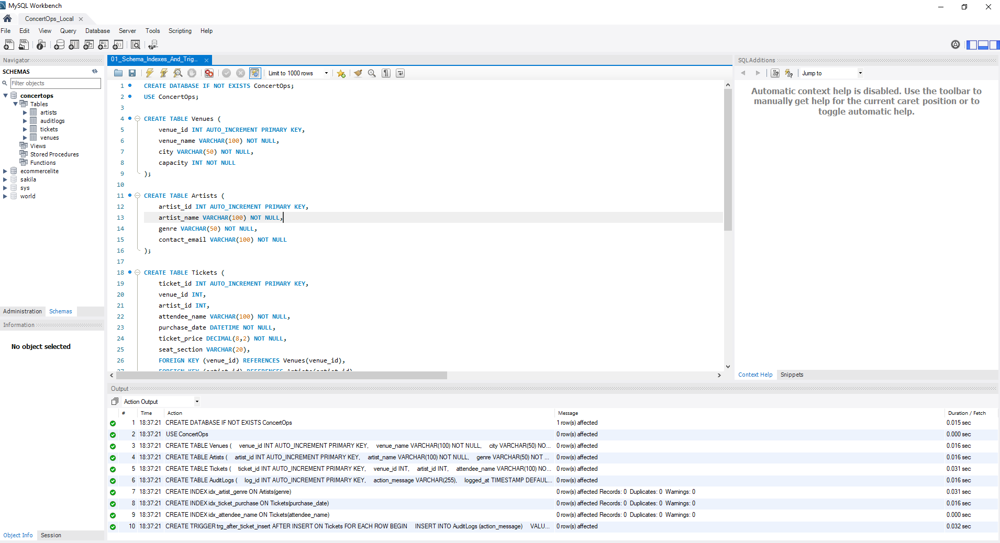
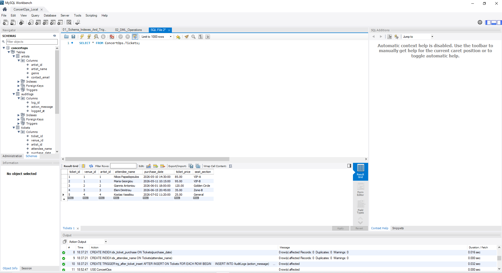
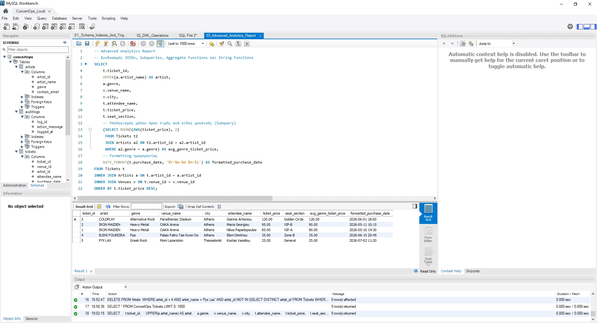
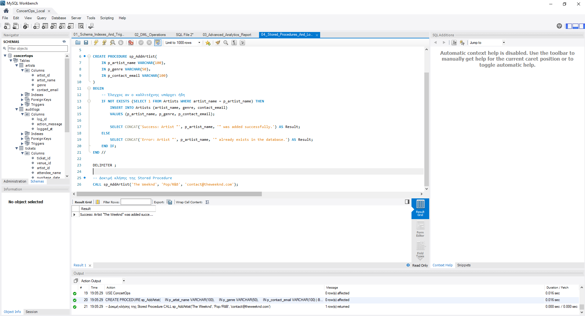

# ConcertOps - MySQL Portfolio Project

A MySQL database project simulating a live event and concert management platform, demonstrating core SQL concepts, relational schema design, triggers, and stored procedures in MySQL Workbench.

---

## 🛠️ Project Structure & Architecture

The project consists of four modular SQL scripts:
1. **`01_Schema_Indexes_And_Triggers.sql`**: Handles Database Creation (`ConcertOps`), Relational Schema Design (DDL), Performance Indexes, and Automated Auditing via Triggers.

2. **`02_DML_Operations.sql`**: Handles Data Population, Price Updates, and Safe Deletions (DML).

3. **`03_Advanced_Analytics_Report.sql`**: Contains complex business queries demonstrating Joins, Aggregate Functions, Subqueries, String Formatting, and Date Formatting.

4. **`04_Stored_Procedures_And_Logic.sql`**: Implements a Stored Procedure (`sp_AddArtist`) with conditional validation logic (`IF/ELSE`) to prevent duplicate record insertion.

---

## 📸 Database Setup & Schema

The database models a live concert ecosystem with four core tables: `Venues`, `Artists`, `Tickets`, and `AuditLogs`.

---

## 📊 Project Execution & Verification Steps

### 1. Schema Creation & Automated Trigger Setup
Creates the relational tables, foreign key constraints, indexes, and an `AFTER INSERT` trigger on the `Tickets` table to log actions automatically.
- **Methods:** `CREATE TABLE`, `FOREIGN KEY`, `CREATE INDEX`, `CREATE TRIGGER`

---

### 2. DML Operations & Data Validation
Populates the database with initial venue, artist, and ticket data, performs ticket price updates, and verifies the populated dataset.
- **Methods:** `INSERT INTO`, `UPDATE`, `DELETE`, `SELECT *`

---

### 3. Advanced Analytics Report
Generates a comprehensive sales and artist report combining multiple tables with aggregate pricing analytics per genre.
- **Methods:** `INNER JOIN`, `Subquery`, `UPPER()`, `DATE_FORMAT()`, `ROUND(AVG())`

---

### 4. Stored Procedures & Business Logic
Executes a custom stored procedure to safely add new artists while ensuring no duplicates are created in the database.
- **Methods:** `DELIMITER`, `CREATE PROCEDURE`, `IF NOT EXISTS`, `CALL`

---

## 🚀 Technologies Used
- **DBMS:** MySQL
- **Tool:** MySQL Workbench
- **Version Control:** Git & GitHub